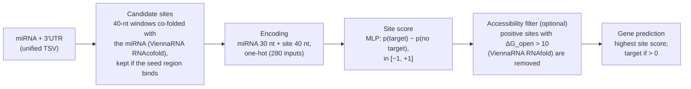

<p align="center">
  
</p>

# pyMIRAW

[](https://github.com/AlbertPlaPlanas/pyMiraw/actions/workflows/ci.yml)
[](https://github.com/AlbertPlaPlanas/pyMiraw/actions/workflows/secrets.yml)
[](pyproject.toml)
[](LICENSE)
[](https://github.com/astral-sh/ruff)
[](https://doi.org/10.1371/journal.pcbi.1006185)
[](#3-status)

Python/PyTorch reimplementation of **miRAW** ([Pla, Zhong & Rayner, PLoS Comput Biol 2018](https://doi.org/10.1371/journal.pcbi.1006185)),
a deep-learning miRNA-target predictor. The original is Java/DL4J
([bitbucket.org/bipous](https://bitbucket.org/bipous/miraw_-dl4mirnatargeting_code)).

> **Work in progress.** Prediction and training are implemented and tested; see [3. Status](#3-status).
> If you use pyMIRAW, please **cite the original miRAW paper** ([Citation](#citation)).

## Contents

1. [How pyMIRAW compares to the original miRAW](#1-how-pymiraw-compares-to-the-original-miraw)
   * [How miRAW predicts targets](#how-miraw-predicts-targets)
   * [Results](#results)
   * [Why the ViennaRNA version matters](#why-the-viennarna-version-matters)
   * [Why retraining does not give the same weights](#why-retraining-does-not-give-the-same-weights)
   * [What is the same and what differs](#what-is-the-same-and-what-differs)
2. [Using pyMIRAW](#2-using-pymiraw)
   * [Installation](#installation)
   * [Tutorial notebook](#tutorial-notebook)
   * [Weights and data](#weights-and-data)
   * [Predicting targets](#predicting-targets)
   * [Output and scores](#output-and-scores)
   * [Choosing the ViennaRNA version](#choosing-the-viennarna-version)
   * [Benchmark and training](#benchmark-and-training)
   * [Python library](#python-library)
3. [Status](#3-status)
4. [Citation](#citation)

---

## 1. How pyMIRAW compares to the original miRAW

### How miRAW predicts targets

pyMIRAW implements the same pipeline as miRAW. The network sees the whole mature miRNA and a 40-nt candidate site, not
only the seed:



The site finders (miRAW, Personalized, PITA, TargetScan) differ only in the seed rule.

### Results

pyMIRAW is checked against the paper by acceptance gates (rules in [docs/PLAN.md](docs/PLAN.md), section 6; result
files in [docs/results/](docs/results/)).

* **With the original checkpoints (`--original-weights`, the default): identical results.** With ViennaRNA 2.2.5, the
  version the paper used, the port is bit-exact: same candidate sites, same site scores and same gene calls. With the
  default ViennaRNA 2.7.2 all 10 configurations stay within 0.005 accuracy and F1 of the published results on the
  paper's 10 balanced test sets (Gate 1; [why](#why-the-viennarna-version-matters)).
* **Training from scratch (same recipe, same folds): comparable results, not identical ones.** Retrained models match the
  paper's own fold models on average (site level: accuracy -0.002, AUC -0.001; gene level: accuracy and F1 within 0.005)
  and pass the non-inferiority test of Gate 2 (99 % one-sided bound within 0.02 accuracy/F1 and 0.005 AUC). Individual
  models, ours and the paper's alike, differ by up to about ±0.03 in gene-level accuracy from fold to fold.

<picture>
  <source media="(prefers-color-scheme: dark)" srcset="docs/figures/gate1_parity-dark.svg">
  
</picture>

<picture>
  <source media="(prefers-color-scheme: dark)" srcset="docs/figures/gate2_folds-dark.svg">
  
</picture>

The figures are drawn from the result files by `scripts/make_readme_figures.py`.

### Why the ViennaRNA version matters

The original miRAW ran the ViennaRNA 2.2 command-line tools; pyMIRAW defaults to the faster ViennaRNA 2.7.2 Python
bindings. ViennaRNA's energy parameters changed between these versions, so a few candidate sites whose binding energy is
close to the cut-off are found (or not) differently, which changes the gene call for very few pairs. The network itself
is unaffected. To reproduce the paper exactly, use ViennaRNA 2.2.5 (see
[Choosing the ViennaRNA version](#choosing-the-viennarna-version)).

### Why retraining does not give the same weights

The training recipe is the original's: Nesterov SGD (momentum 0.9), learning rate 0.005, batch 50, XENT loss, Xavier
initialisation, 10 epochs, training file order. The remaining differences are plausibly due to:

1. **Random initialisation.** DL4J/ND4J and PyTorch use different random number generators, and the paper's seeds are not
   recorded, so the networks start from different weights and converge to different, equally good, minima.
2. **Numerical backend.** The original was trained with DL4J on ND4J (Java, CPU BLAS); pyMIRAW trains with PyTorch, here on a
   GPU (cuBLAS, non-deterministic kernels). Different float32 summation orders give differences of about 1e-7 per step,
   which SGD amplifies over the 2,800 updates of training (280 per epoch) into different final weights.
3. **Framework details.** Small implementation differences can select a different "best" epoch, for example how the
   training loss is measured (DL4J scores the network after the epoch, Lightning averages the mini-batch losses during it).
4. **Amplification at gene level.** A gene is a predicted target if any one of its candidate sites scores positive, so a
   small shift in a model's site-level decision point changes gene-level specificity a lot. This is why retrained models
   agree closely with the paper at site level but vary more at gene level, as the paper's own fold models do.

### What is the same and what differs

| | original miRAW | pyMIRAW |
|---|---|---|
| Network | DL4J MLP 280 → 400-350-300-150-100-100-50-50 → 2 | same architecture in PyTorch; the original weights ship with the package; DL4J `.bin` checkpoints load directly |
| Site finders | miRAW (6-1:10), Personalized, PITA, TargetScan | all four: `miRAW` (6-1:10), `Personalized;<start>;<size>;<min pairs>` (e.g. `Personalized;0;9;7` = 7-1:10, `Personalized;1;9;7` = 7-2:10), `PITA`, `TargetScan` (or `TS`) |
| Filters | AccessibilityEnergy, SpecificZones, ReservedZones | AccessibilityEnergy (the one the paper used); the other two are not ported |
| RNA folding | ViennaRNA 2.2 command-line tools | ViennaRNA 2.7 Python bindings by default; any version's command-line tools |
| Input / output | unified TSV, `targetPredictionOutput.csv`, `targetSites.csv` | same files; YAML configs, and legacy `.properties` files are read |
| Training | DL4J, CPU | PyTorch Lightning, CPU or GPU; any registered architecture ([docs/extending.md](docs/extending.md)) |
| Speed-ups | – | parallel workers; ViennaRNA results (sites and accessibility energies) can be saved and reused (`--sites-dir`) |

---

## 2. Using pyMIRAW

### Installation

```bash
pip install "pymiraw @ git+https://github.com/AlbertPlaPlanas/pyMiraw.git"
```

This installs everything needed to predict and to train, including ViennaRNA 2.7 and the original miRAW weights.
Extras: `pymiraw[data]` (unpack the paper archive), `pymiraw[notebook]` (JupyterLab, matplotlib).

Contributors use the conda environment, which pins every version:

```bash
conda env create -f environment.yml        # or: conda-lock install -n pymiraw conda-lock.yml
conda activate pymiraw
pip install -e . --no-deps
pre-commit install                         # secret guards, once per clone
make test
```

### Tutorial notebook

[notebooks/pymiraw_tutorial.ipynb](notebooks/pymiraw_tutorial.ipynb) walks through everything below with runnable
examples:

* a quick start for non-programmers (predict, read the scores, save the results);
* configuration (site finders, filters, YAML files, the command line, ViennaRNA versions, faster reruns);
* training in the paper's regime, saving and reusing your own weights, other training settings and a custom architecture.

It runs on the bundled example data, without downloads.

### Weights and data

The original miRAW weights are **bundled with the package**: `model="original"` (the default everywhere) uses them,
with nothing to download or configure. They are a bit-exact conversion of the paper's `NetworkModel/bestModel.bin`
(checked by the tests). Set `PYMIRAW_ORIGINAL_WEIGHTS=/path/to/file` to use another copy (`.pt` or DL4J `.bin`).

Also bundled: 24 example pairs and 5,000 labelled training sites (`pymiraw.example_pairs()`, `pymiraw.example_sites()`),
and the paper's published results used by the benchmarks.

Only the benchmarks and full-size training need the authors' data archive (1 GB). Download it once and unpack the parts
pyMIRAW uses into `data/original/`:

```bash
curl -L -o PLOSComb.7z https://bitbucket.org/bipous/miraw_data/raw/master/PLOSComb.7z
pymiraw data unpack-archive PLOSComb.7z      # needs pymiraw[data]
```

```
data/original/Data/TestData/balanced10/                          # the paper's 10 balanced test sets
data/original/Data/CrossVal/RelaxedPW60_14K_35K/binary/          # released CV folds
data/original/NetworkModel/bestModel.bin                         # the original weights (DL4J), source of the bundled copy
data/original/ResultsCV/VeryDeepXENT14K_e10/Set<k>/bestModel.bin # the paper's 9 cross-validation fold models
```

### Predicting targets

The input is the miRAW *unified file*: a TSV with the columns `miRNA, gene_name, EnsemblId, [Positive_Negative,]
Mature_mirna_transcript, 3UTR_transcript` (example: `src/pymiraw/resources/example_pairs.tsv`).

```bash
pymiraw predict  pairs.tsv --name my_run                                  # original weights (the default)
pymiraw evaluate pairs.tsv --filter "AccessibilityEnergy;10" --name my_eval   # with labels: also computes metrics
pymiraw predict  pairs.tsv --model my_model.pt                            # a retrained model
pymiraw predict  -c run.yaml                                              # options from a YAML or legacy .properties file
```

* `--finder`: `miRAW` (default; the paper's 6-1:10), `Personalized;<start>;<size>;<min pairs>` (the paper used
  `Personalized;0;9;7` = 7-1:10 and `Personalized;1;9;7` = 7-2:10), `PITA`, `TargetScan` (or `TS`).
* `--filter` (repeatable): `AccessibilityEnergy;10` removes positive sites whose opening energy is above +10.
* `--workers N`: parallel processes (default: all cores).
* `--sites-dir DIR`: save the ViennaRNA results on the first run and reuse them on later runs, with any model;
  `--require-sites` fails instead of folding.

`pymiraw <command> --help` lists every option; `python -m pymiraw` is the same command.

### Output and scores

Each run writes to `runs/<name>/`: `targetPredictionOutput.csv` (one row per pair), `targetSites.csv` (every candidate
site and its score), `config.yaml` and, for `evaluate`, `metrics.json` (TP/FP/TN/FN, accuracy, F1, ...).

Scores range from -1 to +1. A site's score is p(target) - p(no target) from the network's two outputs, so a score above 0
means p(target) > 0.5. A pair's `Prediction` is the highest score among its sites, and **the pair is predicted as a target
when `Prediction > 0`**. Pairs without candidate sites, and positive sites removed by a filter, score 0 (not a target).
This is the same convention as the original miRAW.

### Choosing the ViennaRNA version

ViennaRNA is used through one of two backends (`--backend`, or `backend:` in a YAML config):

* `bindings` (default): the ViennaRNA Python bindings (`import RNA`) of the active environment; in-process and fast.
  The version is whatever is installed (2.7.2 in `environment.yml`); to change it, install another one, e.g.
  `conda install -c bioconda viennarna=2.6.4` or `pip install ViennaRNA==<version>`.
* `cli`: the `RNAcofold` and `RNAfold` command-line tools of **any** installed version, run as subprocesses (much slower).
  `--vienna-bin DIR` is the folder holding them; without it the tools on the `PATH` are used.

```bash
pymiraw evaluate pairs.tsv --backend cli --vienna-bin /path/to/viennarna/bin
```

To reproduce the paper exactly, use ViennaRNA 2.2.5 from the reference environment:

```bash
conda env create -f environment-reference.yml                         # -> /opt/conda/envs/pymiraw-ref
pymiraw evaluate pairs.tsv --backend cli --vienna-bin /opt/conda/envs/pymiraw-ref/bin
```

The same options work for `pymiraw parity`. Saved results (`--sites-dir`, `--cache-dir`) are keyed by backend and
version, so results from different versions are never mixed.

### Benchmark and training

```bash
pymiraw parity data/original/Data/TestData/balanced10 --output-dir runs/parity     # Gate 1: hours, all cores
pymiraw train  data/original/Data/CrossVal/RelaxedPW60_14K_35K/binary --seeds 3 \
    --no-shuffle --val-fraction 0 --max-epochs 10                                 # the original training regime
make gate2                                                                        # Gate 2 report from docs/results/
```

Other commands: `pymiraw model import-dl4j a.bin b.pt` converts a DL4J checkpoint to a pyMIRAW artefact;
`pymiraw train --orientation natural` encodes the site 5'→3' instead of the original's reversed (3'→5') order.
New architectures (CNN, RNN, Transformer) plug into the same training and prediction code: see
[docs/extending.md](docs/extending.md).

### Python library

Everything the command line does is one function call. The original weights are the default model:

```python
import pymiraw

preds = pymiraw.predict("pairs.tsv")              # or a DataFrame, or [(mirna_seq, utr_seq), ...]
preds.genes                                        # one row per pair: Prediction in [-1, 1], IsTarget, PosSites...
preds.sites                                        # every candidate site and its score
preds.metrics()                                    # when the input has labels: TP/FP/TN/FN, accuracy, F1...
preds.save("runs/my_run")                          # the original miRAW output files

pymiraw.predict("pairs.tsv", finder="PITA", filters="AccessibilityEnergy;10", sites_dir="runs/sites")
pymiraw.predict("pairs.tsv", backend="cli", vienna_bin="/opt/conda/envs/pymiraw-ref/bin")   # ViennaRNA 2.2.5

r = pymiraw.predict_pair(mirna_seq, utr_seq)       # a single pair
r.prediction, r.is_target, [(s.start, s.end, s.score) for s in r.sites]
```

Training returns a `Model` that can be saved and used wherever the original weights are:

```python
model = pymiraw.train(pymiraw.example_sites("train"), pymiraw.example_sites("test"))  # the paper's regime
model.meta["metrics"]                                  # test accuracy, AUC, F1...
model.save("my_model.pt")
pymiraw.predict("pairs.tsv", "my_model.pt")            # or the Model object itself
pymiraw.train(sites, config=pymiraw.TrainConfig(loss="nll", site_orientation="natural", max_epochs=30))
pymiraw.cross_validate("data/original/Data/CrossVal/RelaxedPW60_14K_35K/binary", out_dir="runs/cv")
```

`pymiraw.PredictConfig` and `pymiraw.TrainConfig` hold every setting, with the paper's values as defaults (also as
YAML: `pymiraw.config.load_config("run.yaml")`). `pymiraw.load_model(path)` opens `.pt` and DL4J `.bin` files;
`Model.score_sites(mirna, sites)` scores site sequences directly.

**Code map** for developers (`src/pymiraw/`):

| Module | Role |
|---|---|
| `api.py` | the functions above; start here |
| `config.py` | `PredictConfig`, `TrainConfig`, YAML and legacy `.properties` files |
| `prediction/pipeline.py` | `Predictor` (one pair), `predict_pairs` (parallel driver), `Predictions` |
| `sites/finders/`, `sites/filters/` | candidate-site finders and the accessibility filter (ported from the Java code) |
| `folding/` | ViennaRNA backends (`bindings`, `cli`) and the fold cache |
| `encoding/onehot.py` | the one-hot input encoding, including the original's reversed site orientation |
| `models/` | `SiteClassifier` and the model registry, the miRAW MLP, DL4J import, `Model` artefacts |
| `training/` | Lightning training loop, losses, released-fold loader, cross-validation |
| `evaluation/` | metrics, Gate 1 benchmark, Gate 2 non-inferiority test |
| `resources/` | bundled weights, published results, example data |
| `cli.py` | the `pymiraw` command |

New architectures plug into the same training and prediction code: [docs/extending.md](docs/extending.md).
After changes that could affect results, `python scripts/verify_gates.py` re-runs the gates and compares every number
with the committed results in `docs/results/`.

---

## 3. Status

**Summary (2026-10-29):** the port is functionally complete and self-contained: the original weights ship with the package
and are the default; retrained models pass Gate 2 but have not been promoted to default. Every gate was re-run from scratch
after the API restructure (`scripts/verify_gates.py`) and gave the committed numbers exactly.

| Gate | Result |
|---|---|
| Gate 0: imported paper model vs the paper's cross-validation | passed (identical fold-6 test accuracy, 0.9351428571) |
| Gate 1: pipeline with the original weights vs the published benchmark | passed (100/100 runs) |
| Gate 2: retrained models vs the paper's models | passed; not promoted to default |
| Gate 3: full unbalanced test set | not run yet |

**Remaining:** a decision on promoting a retrained model, running the original `miRAW.jar` side by side (also needed to
compare speed), Gate 3, the SpecificZones and ReservedZones filters (unused by the paper), profiling, PyPI packaging and
the `v1.0.0` release.

Detailed log, numbers and commands: [docs/PROGRESS.md](docs/PROGRESS.md). Design and decisions: [docs/PLAN.md](docs/PLAN.md).
Data sources: [docs/data.md](docs/data.md).

---

## Citation

pyMIRAW is a reimplementation; the method is miRAW's. If you use pyMIRAW, please cite the original paper:

> Pla A, Zhong X, Rayner S (2018). miRAW: A deep learning-based approach to predict microRNA targets by analyzing whole
> microRNA transcripts. *PLoS Computational Biology* 14(7): e1006185. https://doi.org/10.1371/journal.pcbi.1006185

```bibtex
@article{pla2018miraw,
  author  = {Pla, Albert and Zhong, Xiangfu and Rayner, Simon},
  title   = {{miRAW}: A deep learning-based approach to predict {microRNA} targets by analyzing whole {microRNA} transcripts},
  journal = {PLoS Computational Biology},
  year    = {2018},
  volume  = {14},
  number  = {7},
  pages   = {e1006185},
  doi     = {10.1371/journal.pcbi.1006185}
}
```

GitHub's "Cite this repository" button uses [CITATION.cff](CITATION.cff), which points to the same paper.

---

License: MIT (see [LICENSE](LICENSE)). Credentials are never stored in the repository: `.secrets.md` is gitignored and
guarded by pre-commit hooks and CI.
