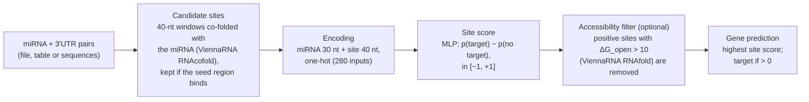
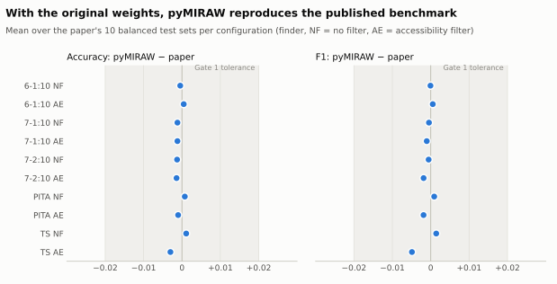
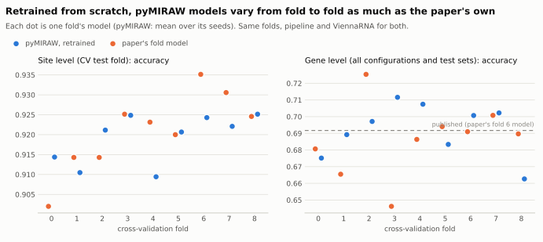

<p align="center">
  
</p>

# pyMIRAW

[](https://github.com/AlbertPlaPlanas/pyMiraw/actions/workflows/ci.yml)
[](https://github.com/AlbertPlaPlanas/pyMiraw/actions/workflows/secrets.yml)
[](pyproject.toml)
[](LICENSE)
[](https://github.com/astral-sh/ruff)
[](https://doi.org/10.1371/journal.pcbi.1006185)
[](#3-status)

Python/PyTorch reimplementation of **miRAW** ([Pla, Zhong & Rayner, PLoS Comput Biol 2018](https://doi.org/10.1371/journal.pcbi.1006185)),
a deep-learning miRNA-target predictor. The original is Java/DL4J
([bitbucket.org/bipous](https://bitbucket.org/bipous/miraw_-dl4mirnatargeting_code)). pyMIRAW reproduces its published
results, ships with the original weights and runs from Python or the command line. To start, see
[Installation](#installation) and [Quick start](#quick-start).

> **Work in progress.** Prediction and training are implemented and tested; see [3. Status](#3-status).
> If you use pyMIRAW, please **cite the original miRAW paper** ([Citation](#citation)).

## Contents

1. [How pyMIRAW compares to the original miRAW](#1-how-pymiraw-compares-to-the-original-miraw)
   * [How miRAW predicts targets](#how-miraw-predicts-targets)
   * [Results](#results)
   * [Why the ViennaRNA version matters](#why-the-viennarna-version-matters)
   * [Why retraining does not give the same weights](#why-retraining-does-not-give-the-same-weights)
   * [What is the same and what differs](#what-is-the-same-and-what-differs)
2. [How to use pyMIRAW](#2-how-to-use-pymiraw)
   * [Installation](#installation)
   * [Quick start](#quick-start)
   * [Tutorial notebook](#tutorial-notebook)
   * [Input: your miRNA-gene pairs](#input-your-mirna-gene-pairs)
   * [Output and scores](#output-and-scores)
   * [Site finders, filters and speed](#site-finders-filters-and-speed)
   * [Choosing the ViennaRNA version](#choosing-the-viennarna-version)
   * [Training and your own weights](#training-and-your-own-weights)
   * [Running on CPU or GPU](#running-on-cpu-or-gpu)
   * [Reproducing the paper's results](#reproducing-the-papers-results)
   * [For developers](#for-developers)
3. [Status](#3-status)
4. [Citation](#citation)

---

## 1. How pyMIRAW compares to the original miRAW

### How miRAW predicts targets

pyMIRAW implements the same pipeline as miRAW. The network sees the whole mature miRNA and a 40-nt candidate site, not
only the seed:



The site finders (miRAW, Personalized, PITA, TargetScan) differ only in the seed rule.

### Results

pyMIRAW is checked against the paper by acceptance gates (rules in [docs/PLAN.md](docs/PLAN.md), section 6; result
files in [docs/results/](docs/results/)).

* **With the original weights (bundled, the default): identical results.** With ViennaRNA 2.2.5, the
  version the paper used, the port is bit-exact: same candidate sites, same site scores and same gene calls. With the
  default ViennaRNA 2.7.2 all 10 configurations stay within 0.005 accuracy and F1 of the published results on the
  paper's 10 balanced test sets (Gate 1; [why](#why-the-viennarna-version-matters)).
* **Training from scratch (same recipe, same folds): comparable results, not identical ones.** Retrained models match the
  paper's own fold models on average (site level: accuracy -0.002, AUC -0.001; gene level: accuracy and F1 within 0.005)
  and pass the non-inferiority test of Gate 2 (99 % one-sided bound within 0.02 accuracy/F1 and 0.005 AUC). Individual
  models, ours and the paper's alike, differ by up to about ±0.03 in gene-level accuracy from fold to fold.

<picture>
  <source media="(prefers-color-scheme: dark)" srcset="docs/figures/gate1_parity-dark.svg">
  
</picture>

<picture>
  <source media="(prefers-color-scheme: dark)" srcset="docs/figures/gate2_folds-dark.svg">
  
</picture>

The figures are drawn from the result files by `scripts/make_readme_figures.py`.

### Why the ViennaRNA version matters

The original miRAW ran the ViennaRNA 2.2 command-line tools; pyMIRAW defaults to the faster ViennaRNA 2.7.2 Python
bindings. ViennaRNA's energy parameters changed between these versions, so a few candidate sites whose binding energy is
close to the cut-off are found (or not) differently, which changes the gene call for very few pairs. The network itself
is unaffected. To reproduce the paper exactly, use ViennaRNA 2.2.5 (see
[Choosing the ViennaRNA version](#choosing-the-viennarna-version)).

### Why retraining does not give the same weights

The training recipe is the original's: Nesterov SGD (momentum 0.9), learning rate 0.005, batch 50, XENT loss, Xavier
initialisation, 10 epochs, training file order. The remaining differences are plausibly due to:

1. **Random initialisation.** DL4J/ND4J and PyTorch use different random number generators, and the paper's seeds are not
   recorded, so the networks start from different weights and converge to different, equally good, minima.
2. **Numerical backend.** The original was trained with DL4J on ND4J (Java, CPU BLAS); pyMIRAW trains with PyTorch, here on a
   GPU (cuBLAS). Different float32 summation orders give differences of about 1e-7 per step, which SGD amplifies over the
   2,800 updates of training (280 per epoch) into different final weights. On the same machine and software, pyMIRAW's
   own retraining is reproducible bit for bit (checked by `scripts/verify_gates.py`).
3. **Framework details.** Small implementation differences can select a different "best" epoch, for example how the
   training loss is measured (DL4J scores the network after the epoch, Lightning averages the mini-batch losses during it).
4. **Amplification at gene level.** A gene is a predicted target if any one of its candidate sites scores positive, so a
   small shift in a model's site-level decision point changes gene-level specificity a lot. This is why retrained models
   agree closely with the paper at site level but vary more at gene level, as the paper's own fold models do.

### What is the same and what differs

| | original miRAW | pyMIRAW |
|---|---|---|
| Installation | Java 8, `miRAW.jar` and the ViennaRNA command-line tools | `pip install`; ViennaRNA and the original weights included |
| Network | DL4J MLP 280 → 400-350-300-150-100-100-50-50 → 2 | same architecture in PyTorch, with the original weights (a bit-exact conversion); DL4J `.bin` checkpoints load directly |
| Site finders | miRAW (6-1:10), Personalized, PITA, TargetScan | all four: `miRAW` (6-1:10), `Personalized;<start>;<size>;<min pairs>` (e.g. `Personalized;0;9;7` = 7-1:10, `Personalized;1;9;7` = 7-2:10), `PITA`, `TargetScan` (or `TS`) |
| Filters | AccessibilityEnergy, SpecificZones, ReservedZones | AccessibilityEnergy (the one the paper used); the other two are not ported |
| RNA folding | ViennaRNA 2.2 command-line tools | ViennaRNA 2.7 Python bindings by default; any version's command-line tools |
| Input / output | unified TSV, `.properties` config, `targetPredictionOutput.csv`, `targetSites.csv` | the same files and configs, plus YAML configs and a Python API (pandas DataFrames in and out) |
| Training | DL4J, CPU | PyTorch Lightning, CPU or GPU, the paper's regime by default; any registered architecture ([docs/extending.md](docs/extending.md)) |
| Speed-ups | – | parallel workers (all cores by default); ViennaRNA results (sites and accessibility energies) can be saved and reused (`sites_dir`) |

---

## 2. How to use pyMIRAW

### Installation

```bash
pip install "pymiraw @ git+https://github.com/AlbertPlaPlanas/pyMiraw.git"
pymiraw --help                                  # check: lists the commands
```

This needs Python 3.11 or later and installs everything needed to predict and to train: PyTorch, ViennaRNA 2.7 and the
original miRAW weights. Nothing else is downloaded later. No GPU is needed; see
[Running on CPU or GPU](#running-on-cpu-or-gpu) for a smaller CPU-only install and for training on a GPU.
Optional extras: `pip install "pymiraw[notebook] @ git+..."` (JupyterLab and matplotlib, for the tutorial) and
`pymiraw[data]` (tools to unpack the paper's data archive, for [reproducing the paper](#reproducing-the-papers-results)).

### Quick start

**Python.** One function call; the original miRAW weights are the default model:

```python
import pymiraw

preds = pymiraw.predict(pymiraw.example_pairs())   # or a file name, a DataFrame, or [(mirna_seq, utr_seq), ...]
preds.genes                                         # one row per pair: Prediction, IsTarget, PosSites, ...
preds.sites                                         # every candidate site and its score
preds.metrics()                                     # the inputs are labelled here: accuracy 0.79, F1 0.81
preds.save("my_results")                            # the original miRAW output files

pair = pymiraw.example_pairs().iloc[0]
r = pymiraw.predict_pair(pair.Mature_mirna_transcript, pair["3UTR_transcript"])   # one miRNA against one 3'UTR
r.prediction, r.is_target                           # (0.9989..., True)
```

**Command line.** The same, on a file:

```bash
python -c "import pymiraw; pymiraw.example_pairs().to_csv('pairs.tsv', sep='\t', index=False)"   # an example input file
pymiraw evaluate pairs.tsv --name first_run      # predicts, and compares with the labels -> runs/first_run/
pymiraw predict  pairs.tsv --name no_labels      # predicts only
```

`pymiraw <command> --help` lists every option; `python -m pymiraw` is the same command.

### Tutorial notebook

[notebooks/pymiraw_tutorial.ipynb](notebooks/pymiraw_tutorial.ipynb) shows most of this section with runnable examples
and their outputs. It uses only the bundled data and runs in about 3 minutes:

1. quick start: predict the example pairs, read the scores, use your own file, a pandas DataFrame or a single pair, save the results;
2. configuration: site finders, filters, YAML configs, the command line, faster reruns, ViennaRNA versions;
3. training: the paper's regime, saving and predicting with your own weights, other training settings, a custom
   architecture, and cross-validation on the paper's data.

To run it:

```bash
pip install "pymiraw[notebook] @ git+https://github.com/AlbertPlaPlanas/pyMiraw.git"
curl -LO https://raw.githubusercontent.com/AlbertPlaPlanas/pyMiraw/main/notebooks/pymiraw_tutorial.ipynb
jupyter lab pymiraw_tutorial.ipynb
```

### Input: your miRNA-gene pairs

`pymiraw.predict` accepts three forms:

* **A file**: the miRAW *unified file*, a tab-separated file with one pair per line (the command line takes only this form).
* **A pandas DataFrame** with the same columns, or just `mirna_seq` and `utr` (optional: `miRNA`, `gene_name`,
  `EnsemblId`, `label`).
* **A list of `(mirna_seq, utr)` tuples.**

| Unified-file column | DataFrame column | Content |
|---|---|---|
| `miRNA` | `miRNA` | miRNA name, e.g. `hsa-let-7a-5p` (optional in a DataFrame) |
| `gene_name`, `EnsemblId` | the same | gene name and id, any text (optional in a DataFrame) |
| `Mature_mirna_transcript` | `mirna_seq` | mature miRNA sequence |
| `3UTR_transcript` | `utr` | the gene's 3'UTR sequence (RNA or DNA letters) |
| `Positive_Negative` | `label` | optional: 1 = known target, 0 = not a target; enables `metrics()` / `evaluate` |

```python
import pandas as pd
import pymiraw

pairs = pd.DataFrame({
    "miRNA": ["hsa-let-7a-5p", "hsa-miR-21-5p"],
    "mirna_seq": ["UGAGGUAGUAGGUUGUAUAGUU", "UAGCUUAUCAGACUGAUGUUGA"],
    "utr": ["UAGCUGAGCGGCGAACCACUAGAAAAGGUUAACUAUACAACCUACUACCUCACAGACCCCGGAGCCCAGCCGUCACGAUUGU"] * 2,
})
pymiraw.predict(pairs).genes      # let-7a: target (the 3'UTR has a let-7 site); miR-21: not a target
```

### Output and scores

`preds.genes` (saved as `targetPredictionOutput.csv`) has one row per pair; `preds.sites` (saved as `targetSites.csv`)
has one row per candidate site. `preds.save(folder)` and the command line (into `runs/<name>/`) also write `config.yaml`
(the settings used). `metrics.json` (TP/FP/TN/FN, accuracy, precision, recall, specificity, F1) is written by
`pymiraw evaluate` and by `preds.save` when the input is labelled.

**Scores range from -1 to +1.** A site's score is p(target) - p(no target) from the network's two outputs, so a score
above 0 means p(target) > 0.5. A pair's `Prediction` is the highest score among its sites, and **the pair is predicted as
a target when `Prediction > 0`** (`IsTarget`). Pairs without candidate sites, and positive sites removed by a filter,
score 0 (not a target). This is the same convention as the original miRAW.

### Site finders, filters and speed

The defaults are the paper's `miRAW-6-1:10` configuration. Python keywords and YAML keys have the same names; the
command-line options are next to them:

| Python / YAML | Command line | Values |
|---|---|---|
| `finder=` | `--finder` | `miRAW` (default; 6-1:10), `Personalized;<start>;<size>;<min pairs>` (the paper used `Personalized;0;9;7` = 7-1:10 and `Personalized;1;9;7` = 7-2:10), `PITA`, `TargetScan` (or `TS`) |
| `filters=` | `--filter` (repeatable) | `AccessibilityEnergy;10` removes positive sites whose opening energy is above 10 kcal/mol (the paper's "AE" configurations) |
| `model=` | `--model` | `original` (default), a `.pt` file, a DL4J `.bin` file, or (Python) a `Model` object |
| `workers=` | `--workers` | parallel processes; default one per CPU core |
| `sites_dir=` | `--sites-dir` | folder that saves the candidate sites and accessibility energies; a rerun with the same finder (any model or threshold) skips ViennaRNA. With `require_sites=True` / `--require-sites`, missing pairs are an error instead of being folded |
| `cache_dir=` | YAML `cache_dir:`; `pymiraw parity --cache-dir` | folder that caches the RNA folds of every 3'UTR window, shared by all finders |
| `backend=`, `vienna_bin=` | `--backend`, `--vienna-bin` | which ViennaRNA to use, see below |

```python
pymiraw.predict("pairs.tsv", finder="PITA", filters="AccessibilityEnergy;10", sites_dir="runs/sites")
```

```bash
pymiraw evaluate pairs.tsv --finder PITA --filter "AccessibilityEnergy;10" --sites-dir runs/sites --name pita_ae
```

All settings of a run form one `pymiraw.PredictConfig`. Keep them in a YAML file and use it from both sides:
`pymiraw predict pairs.tsv -c run.yaml` or `pymiraw.predict("pairs.tsv", config=pymiraw.load_config("run.yaml"))`.
The original miRAW `.properties` files are accepted too. Unknown or misspelled settings are errors, not silently ignored.
Each run's `config.yaml` is a valid config file.

Most of the time goes to RNA folding and grows with 3'UTR length: on 16 cores, the 24 example pairs take about
15 seconds per finder and one of the paper's test sets (about 1,100 pairs) one to two minutes per configuration.

### Choosing the ViennaRNA version

Candidate sites come from RNA folding, so the ViennaRNA version slightly changes the results
([why](#why-the-viennarna-version-matters)). There are two backends:

* `bindings` (default): the ViennaRNA Python package installed with pyMIRAW (2.7.x), in-process and fast. With the
  original weights it reproduces the paper's benchmark within 0.005 accuracy and F1.
* `cli`: the `RNAcofold` and `RNAfold` command-line tools of **any** installed ViennaRNA version, run as subprocesses
  (slower). `vienna_bin` / `--vienna-bin` is the folder holding them; without it the tools on the `PATH` are used.

To reproduce the paper **exactly**, use ViennaRNA 2.2.5, the version miRAW used:

```bash
conda create -n vienna225 -c conda-forge -c bioconda viennarna=2.2.5     # once
pymiraw evaluate pairs.tsv --backend cli --vienna-bin "$(conda info --base)/envs/vienna225/bin"
```

```python
pymiraw.predict("pairs.tsv", backend="cli", vienna_bin="/opt/conda/envs/vienna225/bin")   # your conda path
```

Saved sites and fold caches are keyed by backend and version, so results from different versions are never mixed.

### Training and your own weights

`pymiraw.train` trains a site classifier and returns a `Model`, which can be saved and used wherever the original
weights are. By default it uses the paper's regime (`pymiraw.TrainConfig.paper()`): the paper's network, Nesterov SGD
with learning rate 0.005, batches of 50, XENT loss, 10 epochs in file order, keeping the epoch with the lowest training
loss.

```python
train_sites = pymiraw.example_sites("train")     # 4,000 labelled sites: mirna_seq, site_seq, label
test_sites = pymiraw.example_sites("test")       # 1,000 more, for test metrics
model = pymiraw.train(train_sites, test_sites)   # seconds on the example data
model.meta["metrics"]                            # test accuracy, AUC, F1, ...
model.save("my_model.pt")

pymiraw.predict("pairs.tsv", "my_model.pt")      # or the Model object itself
mine = pymiraw.load_model("my_model.pt")
mine.score_sites(test_sites.mirna_seq[0], list(test_sites.site_seq[:3]))   # site scores in [-1, 1]
```

```bash
pymiraw predict pairs.tsv --model my_model.pt
```

Your own training data is a DataFrame with the same columns (`mirna_seq`, `site_seq` of up to 40 nt, `label`), or
encoded arrays (`pymiraw.encode_sites`). Any `TrainConfig` field can be changed, for example
`pymiraw.train(train_sites, loss="nll", site_orientation="natural", val_fraction=0.1, patience=3, max_epochs=30)`.
Only the defaults reproduce the paper's models; the gates test those. New architectures (CNN, RNN, Transformer)
register under a name and train through the same code: see [docs/extending.md](docs/extending.md) and section 3.5 of
the notebook. `pymiraw.load_model` also opens DL4J `.bin` files, and `pymiraw model import-dl4j a.bin b.pt` converts them.

### Running on CPU or GPU

**Predicting always runs on the CPU cores**, on any machine. Almost all the time goes to RNA folding (ViennaRNA), which
runs only on CPUs, and the network is small, so each worker process keeps it on the CPU. More cores make it faster
(`workers=`, default one per core); a GPU does not, and nothing needs to be set on a GPU machine.

**Training uses a GPU when PyTorch finds one**, and the CPU otherwise. Choose explicitly with `accelerator`:

```python
model = pymiraw.train(train_sites, test_sites, accelerator="cpu")   # "auto" (default), "cpu", "gpu" (NVIDIA CUDA), "mps" (Apple)
```

```bash
pymiraw train data/original/Data/CrossVal/RelaxedPW60_14K_35K/binary --accelerator cpu
```

| | CPU | GPU |
|---|---|---|
| Install | `pip install torch --index-url https://download.pytorch.org/whl/cpu`, then pyMIRAW: a much smaller download | the default `pip install` on Linux includes CUDA (needs an NVIDIA driver); on other systems take the command from [pytorch.org](https://pytorch.org/get-started/locally/) |
| Check | | `python -c "import torch; print(torch.cuda.is_available())"` prints `True` |
| One full training fold (14,000 sites, 10 epochs, paper regime) | 21 s (8 threads) | 14 s (NVIDIA T4) |
| The 4,000 example sites | a few seconds | a few seconds |

The paper's network is small, so a GPU helps little: everything in this README runs comfortably on a CPU-only machine.
To hide a GPU from pyMIRAW, set `CUDA_VISIBLE_DEVICES=""`. `accelerator="auto"` also picks an Apple-silicon GPU (MPS)
when there is one; that has not been tested.

**CPU and GPU training give slightly different models.** They sum floating-point numbers in a different order, so the
same seed ends in different weights: for CV fold 6, test accuracy 0.9286 on the CPU and 0.9231 on the GPU, the same AUC
(0.978). Each device repeats its own result exactly. The committed results (`docs/results/`) were trained on a GPU, so
`make verify-gates` matches them number by number on a GPU; after training on a CPU, the Gate 2 report judges the new
models instead.

### Reproducing the paper's results

The benchmarks need the authors' data archive (1 GB). Download it once and unpack the parts pyMIRAW uses into
`data/original/` (run these from a clone of this repository, see [For developers](#for-developers)):

```bash
curl -L -o PLOSComb.7z https://bitbucket.org/bipous/miraw_data/raw/master/PLOSComb.7z
pymiraw data unpack-archive PLOSComb.7z      # needs the [data] extra
```

```
data/original/Data/TestData/balanced10/                          # the paper's 10 balanced test sets
data/original/Data/CrossVal/RelaxedPW60_14K_35K/binary/          # the released cross-validation folds
data/original/NetworkModel/bestModel.bin                         # the original weights (DL4J), source of the bundled copy
data/original/Results/ResultsCV/VeryDeepXENT14K_e10/Set<k>/bestModel.bin  # the paper's 9 cross-validation fold models
```

Then, on 16 cores (times measured on this project's machine with a T4 GPU):

| What | Command | Time | Output |
|---|---|---|---|
| **All gates, compared number by number with the committed results** | `make verify-gates` | 4-5 h | prints `ALL CHECKS PASSED` |
| Gate 1 only: the benchmark with the original weights (10 test sets x 10 configurations) | `make parity` | 1.5-3 h | `runs/parity/comparison.csv` (committed: `docs/results/gate1_comparison.csv`) |
| Site-level cross-validation only, paper regime (9 folds x 3 seeds, both orientations) | `make train-cv` | 20-30 min (GPU or CPU) | `runs/train_<orientation>/cv_<orientation>.csv` and the models |
| The Gate 2 verdict from the committed result files | `make gate2` | seconds | the table summarised in [3. Status](#3-status) |

`make verify-gates` (`scripts/verify_gates.py`, results in `runs/verify/`) re-runs Gates 0-2 from scratch: Gate 1 with
freshly computed sites, the retraining, and the gene-level runs of the retrained models and of the paper's fold models.
Every confusion count is compared with `docs/results/`, and the Gate 2 report is recomputed from the new runs. The steps
can also be run one at a time (`python scripts/verify_gates.py --help`). Training on other hardware can differ slightly
([why](#why-retraining-does-not-give-the-same-weights)); the Gate 2 report then judges the new models.

### For developers

```bash
git clone https://github.com/AlbertPlaPlanas/pyMiraw.git && cd pyMiraw
conda env create -f environment.yml        # pins every version; or: conda-lock install -n pymiraw conda-lock.yml
conda activate pymiraw
pip install -e . --no-deps
pre-commit install                         # secret and large-file guards, once per clone
make test                                  # the fast tests, as in CI (about 5 minutes)
```

The [Makefile](Makefile) has one-word targets: `test`, `lint`, `parity`, `train-cv`, `gate2`, `verify-gates`.
Code map (`src/pymiraw/`):

| Module | Role |
|---|---|
| `api.py` | `predict`, `predict_pair`, `evaluate`, `train`, `cross_validate`, `load_model`, `encode_sites`; start here |
| `config.py` | `PredictConfig`, `TrainConfig`, YAML and legacy `.properties` files |
| `prediction/pipeline.py` | `Predictor` (one pair), `predict_pairs` (parallel driver), `Predictions` (results) |
| `sites/finders/`, `sites/filters/` | candidate-site finders and the accessibility filter (ported from the Java code) |
| `folding/` | ViennaRNA backends (`bindings`, `cli`) and the fold cache |
| `encoding/onehot.py` | the one-hot input encoding, including the original's reversed site orientation |
| `models/` | `SiteClassifier` and the model registry, the miRAW MLP, DL4J import, `Model` (weights + encoder + metadata) |
| `training/` | Lightning training loop, losses, released-fold loader, cross-validation |
| `evaluation/` | metrics, Gate 1 benchmark, Gate 2 non-inferiority test |
| `resources/` | bundled weights, the paper's published results, example data |
| `cli.py` | the `pymiraw` command |

After any change that could affect results, run `make verify-gates`. The design, decisions and gate rules are in
[docs/PLAN.md](docs/PLAN.md); the work log in [docs/PROGRESS.md](docs/PROGRESS.md); data sources in
[docs/data.md](docs/data.md).

---

## 3. Status

**Summary (2026-10-29):** the port is functionally complete and self-contained: the original weights ship with the package
and are the default; retrained models pass Gate 2 but have not been promoted to default. Every gate was re-run from scratch
after the API restructure (`scripts/verify_gates.py`) and gave the committed numbers exactly.

| Gate | Result |
|---|---|
| Gate 0: imported paper model vs the paper's cross-validation | passed (identical fold-6 test accuracy, 0.9351428571) |
| Gate 1: pipeline with the original weights vs the published benchmark | passed (100/100 runs; every configuration within 0.005) |
| Gate 2: retrained models vs the paper's models | passed; not promoted to default |
| Gate 3: full unbalanced test set | not run yet |

**Remaining:** a decision on promoting a retrained model, running the original `miRAW.jar` side by side (also needed to
compare speed), Gate 3, the SpecificZones and ReservedZones filters (unused by the paper), profiling, PyPI packaging and
the `v1.0.0` release.

To check these results yourself, see [Reproducing the paper's results](#reproducing-the-papers-results). Detailed log,
numbers and commands: [docs/PROGRESS.md](docs/PROGRESS.md). Design and decisions: [docs/PLAN.md](docs/PLAN.md).

---

## Citation

pyMIRAW is a reimplementation; the method is miRAW's. If you use pyMIRAW, please cite the original paper:

> Pla A, Zhong X, Rayner S (2018). miRAW: A deep learning-based approach to predict microRNA targets by analyzing whole
> microRNA transcripts. *PLoS Computational Biology* 14(7): e1006185. https://doi.org/10.1371/journal.pcbi.1006185

```bibtex
@article{pla2018miraw,
  author  = {Pla, Albert and Zhong, Xiangfu and Rayner, Simon},
  title   = {{miRAW}: A deep learning-based approach to predict {microRNA} targets by analyzing whole {microRNA} transcripts},
  journal = {PLoS Computational Biology},
  year    = {2018},
  volume  = {14},
  number  = {7},
  pages   = {e1006185},
  doi     = {10.1371/journal.pcbi.1006185}
}
```

GitHub's "Cite this repository" button uses [CITATION.cff](CITATION.cff), which points to the same paper.

---

License: MIT (see [LICENSE](LICENSE)). Credentials are never stored in the repository: `.secrets.md` is gitignored and
guarded by pre-commit hooks and CI.
